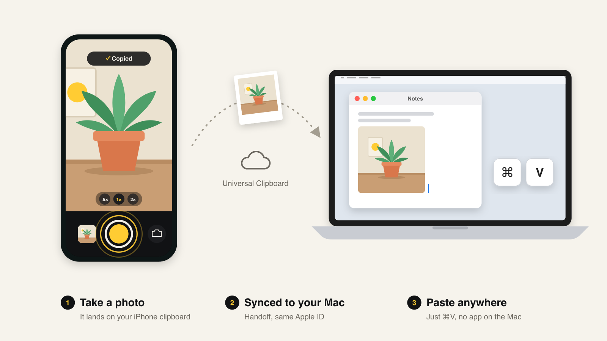

# ClipCam

A tiny PWA camera: take a photo and it goes straight to your clipboard, ready to paste.

With an iPhone and a Mac, Apple's Universal Clipboard carries the photo across: just ⌘V on the Mac. Both need the same Apple ID with Handoff turned on.

- The last 20 photos are kept on your device for up to 7 days. Tap one to copy it again.
- Works offline and can be installed with "Add to Home Screen".
- Plain HTML/JS, no build step.

**Live:** https://unrelatedlabs.github.io/clipcam/

## Multiplatform version

[`multiplatform/`](multiplatform/) does the same thing over your network: a small Python server on your Mac receives each photo from your phone and puts it straight on the Mac's clipboard. See its [README](multiplatform/README.md).

Run locally: `python3 -m http.server` and open http://localhost:8000. The camera needs HTTPS or localhost.
