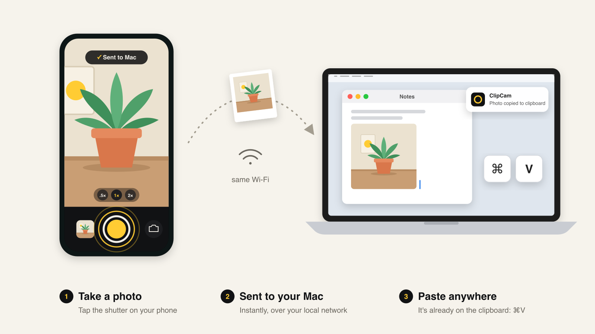

# ClipCam — multiplatform

Take a photo on your phone, and it lands on your Mac's clipboard, ready to ⌘V.



Works from any phone with a modern browser: iPhone (Safari), Android (Chrome,
Firefox, Samsung Internet), tablets, or another laptop. Nothing to install on
the phone; it's a web page.

```
 phone browser ──HTTPS──▶ server.py (Mac)          signaling: POST /offer
 phone browser ══WebRTC data channel══▶ server.py   photo bytes
                                         └─▶ sips → PNG → macOS clipboard
```

## Requirements

- **Mac** (the receiving side): macOS with Python 3.10+. Uses the built-in
  `sips` and `osascript` for the clipboard.
- **Phone**: any browser with WebRTC and camera access (Safari 15+, Chrome,
  Firefox, Samsung Internet).
- Both devices on the **same network** (LAN only, no STUN/TURN servers).

## Run

```sh
./run.sh                                  # first run creates .venv and installs deps
./run.sh --save-dir ~/Pictures/ClipCam    # also keep every photo as a JPEG
./run.sh --port 9000 --no-notify
```

| Option | Default | |
|---|---|---|
| `--port` | `8443` | HTTPS port |
| `--host` | `0.0.0.0` | interface to listen on |
| `--save-dir DIR` | off | also save each photo as a JPEG in `DIR` |
| `--no-notify` | off | skip the macOS notification per photo |
| `-v` | off | verbose WebRTC/ICE logging |

The server prints its URL and a QR code. Scan it with the phone's camera app or
type the URL in the browser.

## First connection: certificate warning

Mobile browsers only allow camera access over HTTPS, so the server creates a
self-signed certificate in `certs/` (regenerated when the Mac's IP changes).
Each browser warns once:

- **iPhone / Safari**: *Show Details* → *visit this website* → *Visit Website*
- **Android / Chrome**: *Advanced* → *Proceed to 192.168.x.x (unsafe)*
- **Firefox**: *Advanced* → *Accept the Risk and Continue*

Then allow camera access when asked.

### Add to home screen

For a full-screen camera with an app icon:

- **iPhone**: Share → *Add to Home Screen*
- **Android**: ⋮ menu → *Add to Home screen* / *Install app*

## Using it

- **Shutter**: captures the current frame and sends it. The Mac copies it and
  shows a notification.
- **Thumbnail** (bottom-left): a spinner while sending, ✓ once it's on the
  clipboard, ! on error. Tap it to send the last photo again.
- **Switch button** (bottom-right): front/back camera.
- **Status pill** (top): the Mac's name when connected. The app reconnects on
  its own (for example after the phone sleeps), and photos taken while offline
  are queued and sent on reconnect.
- If the live camera can't start (permission denied, no HTTPS, old browser), a
  **Take photo** button opens the phone's native camera instead.

## Troubleshooting

- **Page won't load**: check that both devices are on the same Wi-Fi, and that
  the macOS firewall allows incoming connections for Python.
- **Stuck on "Connecting…"**: some guest or corporate Wi-Fi networks isolate
  clients from each other. Use a home network or a phone hotspot.
- **Camera blocked**: re-enable it in the browser's site settings
  (Safari: aA → Website Settings; Chrome: lock icon → Permissions).
- **Stale certificate**: delete `certs/` and restart. The browser will warn again.

## Files

- `server.py`: HTTPS server, WebRTC signaling (`POST /offer`), data channel
  receiver, clipboard
- `static/`: the phone web app (`index.html`, `app.js`, `style.css`, manifest, icons)
- `run.sh`: creates the virtualenv and starts the server
- `requirements.txt`: `aiohttp`, `aiortc`, `cryptography`, `qrcode`

### Data channel protocol

Control messages are JSON text; photo bytes are binary messages of 16 KB.

```
phone → mac   {"type":"begin","id","size"}  <binary chunks…>  {"type":"end","id"}
mac → phone   {"type":"hello","name"} | {"type":"copied","id"} | {"type":"error","id","message"}
```
